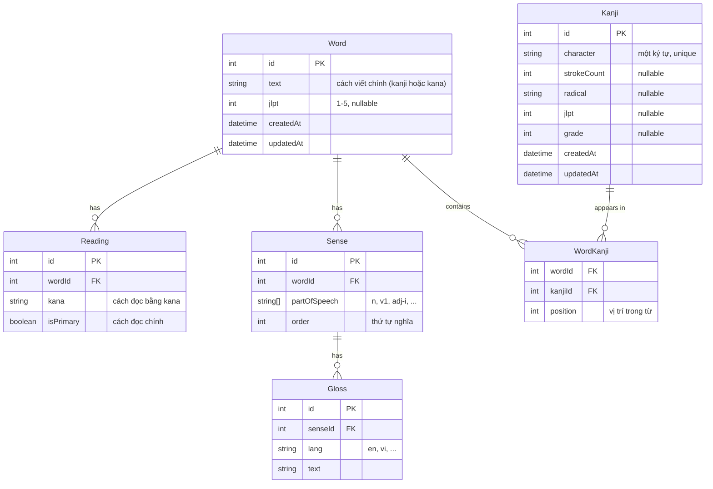

# Data Model — Dictionary

Tài liệu này mô tả mô hình dữ liệu cho từ điển Nhật–Anh, phục vụ Sprint 2 (US-26 trở đi). Nó là thiết kế, chưa phải schema Prisma. Khi team đồng ý, sơ đồ này sẽ được chuyển thành `apps/api/prisma/schema.prisma`.

## Phạm vi

Mô hình này chỉ bao phủ **từ điển**. Không bao gồm:

- User, Session, VerificationToken (đã có trong schema hiện tại)
- Tiến độ học của người dùng (Sprint 3)
- Bài tập, quiz (Sprint 3)
- Ngữ pháp (chưa có US cụ thể)

## Quyết định thiết kế

1. **Word và Kanji là hai thực thể riêng.** Từ (word) là đơn vị tra cứu. Kanji là ký tự Hán tự, có thuộc tính riêng (số nét, bộ thủ). Một từ chứa nhiều kanji; một kanji xuất hiện trong nhiều từ.
2. **Reading là một-nhiều với Word.** Một từ có thể có nhiều cách đọc (にほん, にっぽん).
3. **Sense là một-nhiều với Word; Gloss là một-nhiều với Sense.** Một từ có nhiều nghĩa; mỗi nghĩa có nhiều gloss (tiếng Anh, sau này tiếng Việt).
4. **JLPT level thuộc Word.** Đơn giản, đúng phần lớn trường hợp. Nếu sau này cần chính xác hơn, thêm cột `jlpt` nullable vào `senses` và để code ưu tiên sense-level.

## Sơ đồ ERD

## Giải thích từng bảng

### `words`

Đơn vị tra cứu chính. Một row là một từ.

- `text` — cách viết chính. Với 日本 là `日本`. Với từ không có kanji (ví dụ これ) là kana.
- `jlpt` — 1 đến 5, hoặc `NULL` nếu chưa xác định. JLPT N1 = 1, N5 = 5.
- `createdAt`, `updatedAt` — giống bảng `users`.

Index cần thiết:

- `UNIQUE (text)` — không chắc, vì hai từ khác nhau có thể cùng cách viết? Thực tế hiếm, nhưng đồng âm khác nghĩa có thể cùng kana. Ví dụ 橋 (cầu) và 箸 (đũa) đều viết はし. Vậy **không unique** trên `text`. Nếu cần, dùng `(text, jlpt)` hoặc để code xử lý.
- Index trên `jlpt` cho lọc theo cấp.

### `readings`

Cách đọc của một từ.

- `kana` — chuỗi kana, ví dụ `にほん`.
- `isPrimary` — `true` cho cách đọc chính, `false` cho cách đọc phụ. Một từ có thể có 0 hoặc 1 primary.

Index: `(wordId)`, có thể `UNIQUE (wordId, kana)`.

### `senses`

Một nghĩa của từ.

- `partOfSpeech` — mảng chuỗi theo mã JMdict: `n` (noun), `v1` (ichidan verb), `adj-i` (i-adjective), `adv` (adverb), v.v. Dùng mảng vì một nghĩa có thể vừa là noun vừa là verb.
- `order` — 1, 2, 3... để giữ thứ tự nghĩa như trong JMdict.

Index: `(wordId)`.

### `glosses`

Bản dịch của một nghĩa.

- `lang` — `"en"`, `"vi"`, v.v. Dùng ISO 639-1.
- `text` — nội dung gloss, ví dụ `"to open"`.

Index: `(senseId)`, `(lang)`.

### `kanji`

Ký tự Hán tự riêng lẻ.

- `character` — một ký tự duy nhất, ví dụ `日`. **UNIQUE.**
- `strokeCount` — số nét.
- `radical` — bộ thủ, ví dụ `日` thuộc bộ `日`.
- `jlpt` — cấp JLPT của kanji (khác với cấp của word chứa nó).
- `grade` — cấp học phổ thông Nhật (1–6, 8 cho joyo, 9–10 cho jinmeiyo).

### `word_kanji`

Bảng nối giữa `words` và `kanji`.

- `position` — vị trí kanji trong từ. 日本 có 日 ở vị trí 0, 本 ở vị trí 1.
- Primary key tổng hợp: `(wordId, position)`. **Không** dùng `(wordId, kanjiId)` vì một từ có thể dùng cùng một kanji nhiều lần (ví dụ 木木, hiếm nhưng có).

## Search strategy

Người dùng cần tìm theo ba cách:

1. **Theo kanji** — `SELECT * FROM words WHERE text LIKE '日本%'`. Index thường trên `text` là đủ cho giai đoạn đầu. Nếu dataset lớn, thêm GIN index với `pg_trgm`.
2. **Theo reading** — join `words` với `readings` và tìm theo `kana`. Index trên `readings.kana`.
3. **Theo gloss** — join `words → senses → glosses` và tìm theo `glosses.text` với `lang = 'en'`. Index trên `glosses.text` (hoặc full-text search sau này).

Giai đoạn đầu: dùng `LIKE '%...%'` cho cả ba. Khi dataset đạt ~200k từ (JMdict có khoảng đó), cân nhắc `pg_trgm` hoặc `tsvector`.

## Nguồn dữ liệu và license

Nguồn đề xuất:

- **jmdict-simplified** (JSON) — phiên bản JSON của JMdict, dễ parse. Dùng cho `words`, `readings`, `senses`, `glosses`.
- **kanjidic2** (bản simplified JSON nếu có) — dùng cho `kanji`.

Cả hai đều thuộc **EDRDG License** (Electronic Dictionary Research and Development Group). Tóm tắt điều kiện:

- Được phép dùng, sao chép, phân phối lại, kể cả thương mại.
- Phải ghi công EDRDG trong tài liệu sản phẩm.
- Không được bán riêng dữ liệu từ điển như một sản phẩm độc lập.

**Bắt buộc:** Đọc license gốc tại http://www.edrdg.org/edrdg/licence.html trước khi import, và ghi credit vào README của repo (mục 0.C.6). Đây là việc phải làm trước khi merge bất kỳ PR nào import dữ liệu.

## Tiến hóa schema

Ba thay đổi có khả năng xảy ra, và cách xử lý không phá vỡ schema cũ:

1. **Gloss tiếng Việt** — chỉ thêm row với `lang = 'vi'`. Không đổi schema.
2. **JLPT theo sense** — thêm cột `jlpt` nullable vào `senses`. Code ưu tiên sense-level nếu có, fallback về word-level.
3. **Kanji có nhiều âm on/kun** — thêm bảng `kanji_readings` với `kanjiId`, `kana`, `type` (`on` hoặc `kun`). Không đổi bảng `kanji` hiện tại.

## Việc cần review

Trước khi chuyển sang `schema.prisma`:

- [ ] Tên bảng dùng snake_case (Postgres convention), tên model Prisma dùng PascalCase. Cần thống nhất trước khi sinh migration.
- [ ] `partOfSpeech` dùng mảng chuỗi hay enum? Mảng linh hoạt hơn; enum an toàn hơn nhưng phải liệt kê hết mã JMdict.
- [ ] `words.text` không unique — cần xác nhận với team rằng điều này chấp nhận được.
- [ ] Có cần `createdAt`/`updatedAt` cho các bảng con (`readings`, `senses`, `glosses`) không? Hiện đang bỏ.
